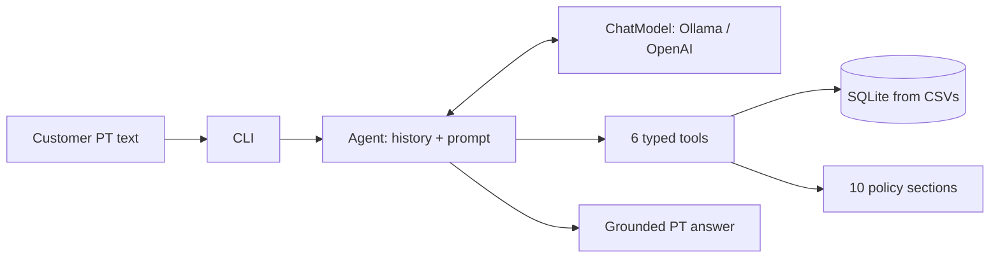

# Emporio da Musica — Text-Message Store Agent

Text-message agent (CLI) that assists the team of Emporio da Musica (fictional
music-instrument store, Campo Grande/MS) by answering customers in Portuguese: catalog
search, prices and PIX discounts, order tracking, policy questions (exchanges, warranty,
payments), and out-of-scope redirection.

The project demonstrates grounding (the model never recalls facts — it reads tool
output), Portuguese text normalization, deterministic pricing rules in code, typed
function calling over two LLM providers, and-warning clean automated tests with 100%
coverage.

Repository: https://github.com/denzelws/artefact-assignment

## Features

- Product search with brand, budget, and in-stock filters.
- Exact prices with PIX/promo math computed in code, never by the model.
- Order tracking with ownership check (tracking code + ETA).
- Policy answers: exchanges (7/30/90-day clocks), payments, shipping, hours.
- Out-of-scope redirection (accessories are not sold — partner redirect).
- Interactive CLI with per-turn JSONL logging (user text, answer, tool calls).
- Two providers: local Ollama (default, free) and OpenAI-compatible API (opt-in).

## Technologies

- **Language:** Python 3.10+
- **Agent:** typed function calling (no framework) over SQLite
- **Persistence:** SQLite loaded from the provided CSVs; policy sections in code
- **LLM clients:** stdlib `urllib` only (Ollama `/api/chat`, OpenAI `/v1/chat/completions`)
- **Config:** pydantic-settings (`EMPORIO_` env prefix)
- **Tests:** pytest, hermetic (HTTP mocked, real datasets) — 85 tests, 100% coverage

## How it works

The customer writes in Portuguese; the agent keeps conversation history, calls tools,
and answers grounded in tool output. The same question always goes through the same
path: history → model → typed tool call → SQLite/policy lookup → answer.



### Business rules (enforced in code or prompt, never recalled)

- The golden rule: never state price, stock, deadline, or order status without calling
  the matching tool first. If a tool returns nothing, say the team will check — never invent.
- PIX: 5% off table price ONLY when `pix_eligible` is true (never on promo prices).
- Installments: up to 3x no minimum (except under R$ 50); 4x–6x min R$ 80/parcela;
  7x–12x min R$ 100/parcela. Minima verified BEFORE offering (R$ 500 cannot go 12x).
- Regional shipping: free above R$ 500, else R$ 35 flat (1–3 business days).
- Clocks: online regret 7 calendar days; manufacturing defect 30 days; legal warranty
  90 days. The situation is qualified BEFORE any number is quoted.
- Scope: the store sells ONLY instruments. Accessories redirect to partner stores —
  never listed, never offered as alternatives.
- Unknown brand/model or empty search: search first and broad (fuzzy match may find it,
  e.g. "Memph" → Tagima Memphis); if truly absent, say so and redirect to real stock.
  Presenting unlisted products is treated as false advertising.
- Complaints: empathy first, 24h callback promised, no improvised solutions.

### Technical decisions

- **Function calling, not RAG or a SQL agent.** Structured data with known access
  patterns needs six typed functions with validated arguments — testable, no wrong
  `WHERE` clause possible. Ten policy sections fit ranked keyword search; embeddings
  would add a dependency and a failure mode for zero gain at this size.
- **Local model by default, paid provider opt-in.** Zero cost, private customer data,
  reproducible demos. Both clients implement one `ChatModel` protocol — switching is
  one env var. Graded transcripts use `qwen2.5:7b`.
- **Single model per deployment, no router.** A 3b→7b cascade was rejected: two resident
  models cost more RAM than one 7b, the router becomes a new failure point, and 7b
  handles every tested category.
- **Temperature 0.2.** Same question, same answer. Measured: tool-less direct answers
  fell from ~1-in-3 runs at 1.0 to 3-for-3 tool calls at 0.2 on llama3.2:3b.
- **Rules plus few-shot examples.** Rules alone lost to model priors twice (scope
  inversion; invented-brand attack) — every hard rule now ships with an example to imitate.
- **Portuguese matching in code.** Plurals, residue tokens ("até R$1000" as text vs
  `max_price`), singular categories — normalized on both sides, because the model varies
  wording run to run.
- **Trust method: verify, don't assume.** Green tests never ended an investigation —
  every live session was graded against the database by hand. That distrust found a
  connection leak, silent insert rollbacks, and category mismatches. Remaining failures
  are located with one question — *"road or messenger?"* — answered from the per-turn
  tool log, and the full incident history is preserved in `plan.md` §10.

## Tool contract

Six tools; each takes validated JSON arguments and returns a JSON envelope
(`{"ok": true, "result": [...]}`). Example — product search:

```json
// search_products {"category": "violoes", "query": "Tagima", "max_price": 1000, "in_stock_only": true}
{"ok": true, "result": [
{"product_id": 83, "name": "Tagima Memphis AC-39 Nylon Natural", "price_brl": 429.9,
"status": "active", "stock_quantity": 15, "promo_price": null,
"pix_eligible": true, "pix_price": 408.4}
]}
```

| Tool | Purpose |
|---|---|
| `search_products` | Fuzzy PT search + brand/budget/stock filters |
| `get_product` | Full detail of one product, with computed prices |
| `get_promotions` | Active promos, per product or store-wide |
| `get_order_status` | Ownership-checked status + tracking + ETA |
| `search_policies` | Ranked answers from the store manual |
| `get_store_info` | Address, hours, contact channels |

## Tests

```sh
.venv/bin/python -m pytest tests/ -q                                   # 85 tests, no network
.venv/bin/pip install pytest-cov
.venv/bin/python -m pytest tests/ -q --cov=emporio --cov-report=term-missing   # 100%
.venv/bin/python -m pytest tests/ -q -W error                          # warning-clean
```

Provider clients are tested against mocked HTTP (payloads, headers, tool-call parsing,
every error branch). The agent loop runs against a scripted fake model with real tools;
the CLI against a stubbed agent with scripted input.

## How to run

### Prerequisites

- Python 3.10+
- [Ollama](https://ollama.com) running locally (only for live chat, not for tests)

### Setup and chat

```sh
python -m venv .venv
.venv/bin/pip install -e . pytest
cp .env.example .env                  # optional: defaults already target local Ollama
ollama pull llama3.1:8b               # default model (or set EMPORIO_OLLAMA_MODEL)
.venv/bin/python -m emporio.cli       # chat in Portuguese; type 'sair' to quit
```

Every turn is appended to `sessions.jsonl` (user text, answer, tool calls) — the raw
material for the transcripts in `examples/`.

### Configuration

| Variable | Default | Purpose |
|---|---|---|
| `EMPORIO_MODEL_PROVIDER` | `ollama` | `ollama` (local, free) or `openai` (paid API) |
| `EMPORIO_OLLAMA_MODEL` | `llama3.1:8b` | Any model served by Ollama |
| `EMPORIO_OLLAMA_HOST` | `http://localhost:11434` | Ollama endpoint |
| `EMPORIO_OPENAI_API_KEY` / `EMPORIO_OPENAI_MODEL` | — / `gpt-4o-mini` | Paid provider (key required) |
| `EMPORIO_TEMPERATURE` | `0.2` | Sampling temperature, both providers |

```sh
EMPORIO_OLLAMA_MODEL=qwen2.5:7b .venv/bin/python -m emporio.cli          # switch model
EMPORIO_MODEL_PROVIDER=openai EMPORIO_OPENAI_API_KEY=sk-... .venv/bin/python -m emporio.cli
.venv/bin/python scripts/live_qa.py                                     # scripted QA (needs Ollama)
```

## Sample conversations

| File | Scenario | Result |
|---|---|---|
| [conversation_01_catalog.md](examples/conversation_01_catalog.md) | Violões ≤ R$1000 + brand follow-up | Grounded list, budget inherited, shortlist + question |
| [conversation_02_tracking.md](examples/conversation_02_tracking.md) | Order-8 tracking | Name greeting, tracking code, ETA — all tool-copied |
| [conversation_03_policies.md](examples/conversation_03_policies.md) | PIX rule + 10-day exchange | Conditional stated, 10 > 7 concluded |
| [conversation_04_redteam.md](examples/conversation_04_redteam.md) | **Non-trivial:** invented-brand attack, then the fix | Full hallucination → textbook redirect after a 2-sentence prompt fix |
| [conversation_05_store_and_price.md](examples/conversation_05_store_and_price.md) | Store address + exact Takamine GD20 price | Tool-grounded info and price |

Raw QA drafts (including failing small-model runs) are kept as `examples/draft_live_qa_*.md`.

## Scope limitations

This version focuses on text-message assistance over the provided datasets. Not part of
this delivery:

- Authentication or customer login (order tracking asks for the order id, nothing more).
- Cross-session customer memory (history lives per session + local JSONL log).
- Freight quotes by CEP (fixed regional bands only).
- Production hardening: rate limiting, PII redaction in logs, multi-attendant Concurrency.
- Live-tested paid provider (OpenAI path is contract-tested with mocks, not with a real key).
- Locally-tested default model (`llama3.1:8b` configured, quality evidence from 3b and qwen-7b).

Small-model honesty: llama3.2:3b states the PIX conditional correctly ~1 run in 3 and
occasionally answers without calling tools. Per-product PIX math is tool-computed and
graded evidence comes from qwen2.5:7b — the numbers, not the adjectives, are in
`examples/` and `plan.md` §10.

With more time: a scored eval harness (fixed question set, graded re-runs per model);
a prompt-condense pass (70 lines compete with tool schemas for small-model attention);
consent-based cross-session memory.

## AI-assistant disclosure

Developed with Cursor (Muse Spark) as a pair-programming assistant: scaffolding and
boilerplate; test-driven fixes (failing test first, then the fix); diagnosis of live
failures from the tool-call log; analysis of red-team transcripts. The developer ran
every `git` command, drove all manual QA (including the invented-brand attack that
exposed the worst hallucination), made all architecture decisions, and graded every
model answer. Nothing was committed without explicit review — the 21-commit history,
including honest failure grades, is the workflow receipts.

## Author

**Denzel Washington Santana Barbosa**
